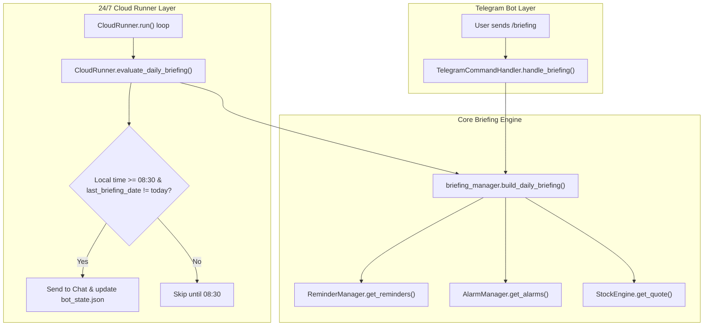

# Daily Morning Briefing Implementation Plan

> **For agentic workers:** REQUIRED SUB-SKILL: Use superpowers:subagent-driven-development to implement this plan task-by-task. Steps use checkbox (`- [ ]`) syntax for tracking.

**Goal:** Build a daily morning briefing for TickerPing (Lainey) delivering today's reminders, market benchmarks (SPY/QQQ), and active stock alarms automatically at 08:30 Israel time (`Asia/Jerusalem`), as well as on-demand via `/briefing`.

**Architecture:** A standalone generator module `briefing_manager.py` produces the formatted briefing by querying `ReminderManager`, `AlarmManager`, and `StockEngine`. `CloudRunner` runs 24/7 on GitHub Actions, evaluating once daily at $\ge$ 08:30 against `bot_state.json` (`last_briefing_date`), while `TelegramCommandHandler` routes manual `/briefing` queries to the same generator.

**Architecture Diagram:**



**Tech Stack:** Python 3.12, ZoneInfo (`Asia/Jerusalem`), pytest, python-telegram-bot / Telegram Bot HTTP API, yfinance / StockEngine.

## Global Constraints
- **Git Identity:** EXCLUSIVELY use `droritos` (`droritos@users.noreply.github.com`) for all git commits, authors, and GitHub pushes.
- **Timezone:** Default to `Asia/Jerusalem` (via `get_bot_timezone()`).
- **Resilience:** Quote fetch failures or empty data must never crash the briefing; fallbacks must display clean placeholders.
- **HTML Escaping:** Any text originating from alarms, notes, or reminders must pass through `html.escape`.

---

### Task 1: `briefing_manager.py` (Core Generator & Unit Tests)

**Files:**
- Create: `C:\Users\DrorVizel\Documents\GitHub\TickerPing\briefing_manager.py`
- Create: `C:\Users\DrorVizel\Documents\GitHub\TickerPing\tests\test_briefing_manager.py`

**Interfaces:**
- Consumes:
  - `ReminderManager.get_reminders(include_completed=False) -> List[Dict[str, Any]]`
  - `AlarmManager.get_alarms() -> List[Dict[str, Any]]`
  - `StockEngine.get_quote(ticker: str) -> Optional[Quote]`
  - `reminders_manager.get_bot_timezone() -> ZoneInfo`
- Produces:
  - `build_daily_briefing(reminder_manager: ReminderManager, alarm_manager: AlarmManager, engine: StockEngine, tz: Optional[ZoneInfo] = None, now: Optional[datetime] = None) -> str`

- [ ] **Step 1: Write the failing tests in `tests/test_briefing_manager.py`**

```python
from datetime import datetime
from unittest.mock import MagicMock
from zoneinfo import ZoneInfo
import pytest

from engine import Quote
from reminders_manager import ReminderManager
from alarms_manager import AlarmManager
from briefing_manager import build_daily_briefing


@pytest.fixture
def mock_engine():
    engine = MagicMock()

    def get_quote_side_effect(ticker):
        t = ticker.upper()
        if t == "SPY":
            return Quote(ticker="SPY", price=580.50, change=2.50, change_percent=0.43, company_name="SPDR S&P 500")
        elif t == "QQQ":
            return Quote(ticker="QQQ", price=490.00, change=-1.20, change_percent=-0.24, company_name="Invesco QQQ")
        elif t == "AAPL":
            return Quote(ticker="AAPL", price=230.00, change=1.00, change_percent=0.44, company_name="Apple Inc.")
        elif t == "NVDA":
            return Quote(ticker="NVDA", price=140.00, change=-2.00, change_percent=-1.41, company_name="Nvidia Corp.")
        return None

    engine.get_quote.side_effect = get_quote_side_effect
    return engine


def test_build_daily_briefing_full(tmp_path, mock_engine):
    tz = ZoneInfo("Asia/Jerusalem")
    now = datetime(2026, 10, 19, 8, 30, 0, tzinfo=tz)

    rem_mgr = ReminderManager(str(tmp_path / "reminders.json"))
    # Add reminder for today
    rem_mgr.add_reminder("Team Standup", due_at=datetime(2026, 10, 19, 9, 30, 0, tzinfo=tz))
    # Add reminder for tomorrow (should not show up in today's section)
    rem_mgr.add_reminder("Tomorrow Task", due_at=datetime(2026, 10, 20, 10, 0, 0, tzinfo=tz))

    alarm_mgr = AlarmManager(str(tmp_path / "alarms.json"))
    alarm_mgr.add_alarm("AAPL", 240.0, "ABOVE", note="Breakout")
    alarm_mgr.add_alarm("NVDA", 130.0, "BELOW")

    briefing = build_daily_briefing(rem_mgr, alarm_mgr, mock_engine, tz=tz, now=now)

    # Greeting & Date
    assert "Good morning" in briefing
    assert "Monday, 19 October 2026" in briefing

    # Reminders
    assert "Team Standup" in briefing
    assert "[09:30]" in briefing
    assert "Tomorrow Task" not in briefing

    # Market Pulse
    assert "SPY" in briefing
    assert "580.50" in briefing
    assert "+0.43%" in briefing
    assert "QQQ" in briefing
    assert "490.00" in briefing

    # Tracked Alarms
    assert "AAPL" in briefing
    assert "NVDA" in briefing
    assert "240.00" in briefing


def test_build_daily_briefing_empty(tmp_path, mock_engine):
    tz = ZoneInfo("Asia/Jerusalem")
    now = datetime(2026, 10, 19, 8, 30, 0, tzinfo=tz)

    rem_mgr = ReminderManager(str(tmp_path / "reminders.json"))
    alarm_mgr = AlarmManager(str(tmp_path / "alarms.json"))

    briefing = build_daily_briefing(rem_mgr, alarm_mgr, mock_engine, tz=tz, now=now)

    assert "No reminders scheduled for today" in briefing
    assert "No active price alarms set" in briefing


def test_build_daily_briefing_html_escaping(tmp_path, mock_engine):
    tz = ZoneInfo("Asia/Jerusalem")
    now = datetime(2026, 10, 19, 8, 30, 0, tzinfo=tz)

    rem_mgr = ReminderManager(str(tmp_path / "reminders.json"))
    rem_mgr.add_reminder("Buy milk & bread <organic>", due_at=datetime(2026, 10, 19, 11, 0, 0, tzinfo=tz))

    alarm_mgr = AlarmManager(str(tmp_path / "alarms.json"))
    alarm_mgr.add_alarm("AAPL", 240.0, "ABOVE", note="Check <resistance> & breakout")

    briefing = build_daily_briefing(rem_mgr, alarm_mgr, mock_engine, tz=tz, now=now)

    assert "Buy milk &amp; bread &lt;organic&gt;" in briefing
    assert "Check &lt;resistance&gt; &amp; breakout" in briefing


def test_build_daily_briefing_quote_failure_resilience(tmp_path):
    tz = ZoneInfo("Asia/Jerusalem")
    now = datetime(2026, 10, 19, 8, 30, 0, tzinfo=tz)

    rem_mgr = ReminderManager(str(tmp_path / "reminders.json"))
    alarm_mgr = AlarmManager(str(tmp_path / "alarms.json"))
    alarm_mgr.add_alarm("UNKNOWN", 100.0)

    engine = MagicMock()
    engine.get_quote.side_effect = Exception("Network timeout")

    briefing = build_daily_briefing(rem_mgr, alarm_mgr, engine, tz=tz, now=now)

    assert "SPY: Price unavailable" in briefing
    assert "UNKNOWN" in briefing
```

- [ ] **Step 2: Run test to verify it fails**

Run in `C:\Users\DrorVizel\Documents\GitHub\TickerPing`:
`python -m pytest tests/test_briefing_manager.py -v`
Expected: FAIL with `ModuleNotFoundError: No module named 'briefing_manager'`

- [ ] **Step 3: Implement `briefing_manager.py`**

Create `C:\Users\DrorVizel\Documents\GitHub\TickerPing\briefing_manager.py`:
```python
"""
briefing_manager.py — Personalized Daily Morning Briefing Generator for TickerPing (Lainey).
Aggregates today's reminders, market benchmark indices (SPY/QQQ), and tracked stock alarms.
"""
from datetime import datetime
import html
import logging
from typing import Optional
from zoneinfo import ZoneInfo

from alarms_manager import AlarmManager
from engine import StockEngine
from reminders_manager import ReminderManager, get_bot_timezone

logger = logging.getLogger(__name__)


def build_daily_briefing(
    reminder_manager: ReminderManager,
    alarm_manager: AlarmManager,
    engine: StockEngine,
    tz: Optional[ZoneInfo] = None,
    now: Optional[datetime] = None
) -> str:
    """
    Build a comprehensive, beautifully formatted Telegram HTML daily briefing.
    """
    if tz is None:
        tz = get_bot_timezone()
    if now is None:
        now = datetime.now(tz)
    elif now.tzinfo is None:
        now = now.replace(tzinfo=tz)

    date_str = now.strftime("%A, %d %B %Y")

    # 1. Reminders Section
    active_reminders = reminder_manager.get_reminders(include_completed=False)
    todays_reminders = []
    for r in active_reminders:
        due_at_str = r.get("due_at")
        if due_at_str:
            try:
                due_dt = datetime.fromisoformat(due_at_str)
                if due_dt.tzinfo:
                    due_dt = due_dt.astimezone(tz)
                if due_dt.date() == now.date():
                    todays_reminders.append((due_dt, r))
            except Exception:
                pass
        else:
            # Untimed reminder created today or active
            pass

    # Sort today's reminders chronologically
    todays_reminders.sort(key=lambda x: x[0])

    if todays_reminders:
        reminder_lines = [f"⏰ <b>Today's Reminders ({len(todays_reminders)}):</b>"]
        for dt, r in todays_reminders:
            time_badge = dt.strftime("%H:%M")
            escaped_title = html.escape(r.get("title", "Reminder"))
            reminder_lines.append(f"  • <b>[{time_badge}]</b> {escaped_title}")
    else:
        reminder_lines = [
            "⏰ <b>Today's Reminders:</b>",
            "  🎉 <i>No reminders scheduled for today! Enjoy your day.</i>"
        ]

    # 2. Market Pulse Section (SPY & QQQ)
    market_lines = ["📊 <b>Market Pulse:</b>"]
    for sym, name in [("SPY", "S&P 500"), ("QQQ", "Nasdaq")]:
        try:
            quote = engine.get_quote(sym)
            if quote and quote.price is not None:
                chg_pct = quote.change_percent or 0.0
                emoji = "🟢" if chg_pct >= 0 else "🔴"
                sign = "+" if chg_pct >= 0 else ""
                market_lines.append(
                    f"  • {name} (<b>{sym}</b>): ${quote.price:,.2f} ({sign}{chg_pct:.2f}% {emoji})"
                )
            else:
                market_lines.append(f"  • {name} (<b>{sym}</b>): <i>Price unavailable</i>")
        except Exception as e:
            logger.warning(f"Error fetching quote for {sym}: {e}")
            market_lines.append(f"  • {name} (<b>{sym}</b>): <i>Price unavailable</i>")

    # 3. Tracked Alarms Section
    active_alarms = [a for a in alarm_manager.get_alarms() if not a.get("triggered", False)]
    if active_alarms:
        alarm_lines = [f"🎯 <b>Your Tracked Alarms ({len(active_alarms)}):</b>"]
        for a in active_alarms:
            ticker = a.get("ticker", "").upper()
            target = a.get("target_price", 0.0)
            direction = a.get("direction", "ABOVE")
            note = a.get("note", "").strip()

            try:
                quote = engine.get_quote(ticker)
            except Exception:
                quote = None

            escaped_ticker = html.escape(ticker)
            if quote and quote.price:
                curr_price = quote.price
                diff_pct = ((target - curr_price) / curr_price) * 100.0
                dist_str = f"{abs(diff_pct):.1f}% away"
                chg_str = f" ({quote.change_percent:+.2f}%)" if quote.change_percent is not None else ""
                line = f"  • <b>{escaped_ticker}</b>: ${curr_price:,.2f}{chg_str} | Target: ${target:,.2f} {direction} (<i>{dist_str}</i>)"
            else:
                line = f"  • <b>{escaped_ticker}</b>: Target: ${target:,.2f} {direction}"

            if note:
                line += f" — <i>{html.escape(note)}</i>"
            alarm_lines.append(line)
    else:
        alarm_lines = [
            "🎯 <b>Your Tracked Alarms:</b>",
            "  <i>No active price alarms set.</i>"
        ]

    # Assemble Full Briefing Message
    sections = [
        "🌅 <b>Good morning! Lainey's Daily Briefing</b>\n"
        "━━━━━━━━━━━━━━━━━━━━━━━━━━\n"
        f"📅 <i>{date_str}</i>\n",
        "\n".join(reminder_lines),
        "\n".join(market_lines),
        "\n".join(alarm_lines),
        "\n💡 <i>\"Stay focused, hydrated, and ready to conquer the day!\"</i> 🐾"
    ]

    return "\n\n".join(sections)
```

- [ ] **Step 4: Run test to verify it passes**

Run: `python -m pytest tests/test_briefing_manager.py -v`
Expected: 4 passed.

- [ ] **Step 5: Commit**

```bash
git add briefing_manager.py tests/test_briefing_manager.py
git commit --author="droritos <droritos@users.noreply.github.com>" -m "feat(briefing): implement briefing_manager core generator and unit tests"
```

---

### Task 2: Cloud Runner Integration (`cloud_runner.py`)

**Files:**
- Modify: `C:\Users\DrorVizel\Documents\GitHub\TickerPing\cloud_runner.py`
- Modify: `C:\Users\DrorVizel\Documents\GitHub\TickerPing\tests\test_cloud_runner.py`

**Interfaces:**
- Consumes: `briefing_manager.build_daily_briefing`, `get_bot_timezone()`
- Produces: `CloudRunner.evaluate_daily_briefing()`

- [ ] **Step 1: Write failing tests in `tests/test_cloud_runner.py`**

Add tests for:
1. `test_evaluate_daily_briefing_triggers_at_0830`: verifies that when local time is $\ge$ 08:30 and `last_briefing_date != today`, the briefing is sent and state updated.
2. `test_evaluate_daily_briefing_idempotent`: verifies that if `last_briefing_date == today`, it does not send duplicate briefings.
3. `test_evaluate_daily_briefing_skips_before_0830`: verifies it does not trigger before 08:30.

- [ ] **Step 2: Run test to verify failure**

Run: `python -m pytest tests/test_cloud_runner.py -k "daily_briefing" -v`
Expected: FAIL.

- [ ] **Step 3: Implement in `cloud_runner.py`**

1. Import `build_daily_briefing` from `briefing_manager`.
2. Add `evaluate_daily_briefing(self)` to `CloudRunner`:
```python
    def evaluate_daily_briefing(self) -> bool:
        """Evaluate if the morning daily briefing is due and send it."""
        try:
            tz = get_bot_timezone()
            now = datetime.now(tz)
            # Threshold: 08:30 or later
            if now.hour < 8 or (now.hour == 8 and now.minute < 30):
                return False

            today_str = now.strftime("%Y-%m-%d")
            last_date = self.state_manager.get("last_briefing_date")
            if last_date == today_str:
                return False

            briefing_text = build_daily_briefing(
                reminder_manager=self.reminder_manager,
                alarm_manager=self.alarm_manager,
                engine=self.engine,
                tz=tz,
                now=now
            )

            sent = self.send_telegram_msg(self.chat_id, briefing_text)
            if sent:
                self.state_manager.set("last_briefing_date", today_str)
                self.git_sync_changes()
                logger.info(f"Daily morning briefing successfully sent for {today_str}!")
                return True
        except Exception as e:
            logger.error(f"Error evaluating daily briefing: {e}")
        return False
```
3. In `run()` loop:
   Call `self.evaluate_daily_briefing()` in the periodic evaluation section.

- [ ] **Step 4: Run test to verify it passes**

Run: `python -m pytest tests/test_cloud_runner.py -v`
Expected: All pass.

- [ ] **Step 5: Commit**

```bash
git add cloud_runner.py tests/test_cloud_runner.py
git commit --author="droritos <droritos@users.noreply.github.com>" -m "feat(runner): integrate automated 08:30 daily briefing in CloudRunner"
```

---

### Task 3: Telegram Routing & Help Documentation (`telegram_command_handler.py`)

**Files:**
- Modify: `C:\Users\DrorVizel\Documents\GitHub\TickerPing\telegram_command_handler.py`
- Modify: `C:\Users\DrorVizel\Documents\GitHub\TickerPing\tests\test_telegram_command_handler.py`

**Interfaces:**
- Consumes: `briefing_manager.build_daily_briefing`
- Produces: `TelegramCommandHandler.handle_briefing(chat_id)`

- [ ] **Step 1: Write failing tests in `tests/test_telegram_command_handler.py`**

Add test:
`test_briefing_command`: verifies `/briefing` triggers `handle_briefing` and sends briefing text with `MAIN_MENU_KEYBOARD`.

- [ ] **Step 2: Run test to verify failure**

Run: `python -m pytest tests/test_telegram_command_handler.py -k "test_briefing_command" -v`
Expected: FAIL.

- [ ] **Step 3: Implement in `telegram_command_handler.py`**

1. Import `build_daily_briefing` from `briefing_manager`.
2. In `handle_update`:
   Match `cmd in ("/briefing", "/morning", "briefing", "morning")` -> `self.handle_briefing(chat_id)`.
3. Implement `handle_briefing(self, chat_id: str)`:
```python
    def handle_briefing(self, chat_id: str) -> None:
        """Generate and send on-demand daily morning briefing."""
        msg = build_daily_briefing(
            reminder_manager=self.reminder_manager,
            alarm_manager=self.alarm_manager,
            engine=self.engine
        )
        self._send(chat_id, msg, reply_markup=MAIN_MENU_KEYBOARD)
```
4. Update `handle_help` to document:
   `• <code>/briefing</code> — Morning summary of market & today's reminders`

- [ ] **Step 4: Run test to verify it passes**

Run: `python -m pytest tests/test_telegram_command_handler.py -k "test_briefing_command" -v`
And run full suite: `python -m pytest`
Expected: All 150+ tests pass.

- [ ] **Step 5: Commit & Push**

```bash
git add telegram_command_handler.py tests/test_telegram_command_handler.py
git commit --author="droritos <droritos@users.noreply.github.com>" -m "feat(telegram): add /briefing on-demand command and update help docs"
git push origin main
```
